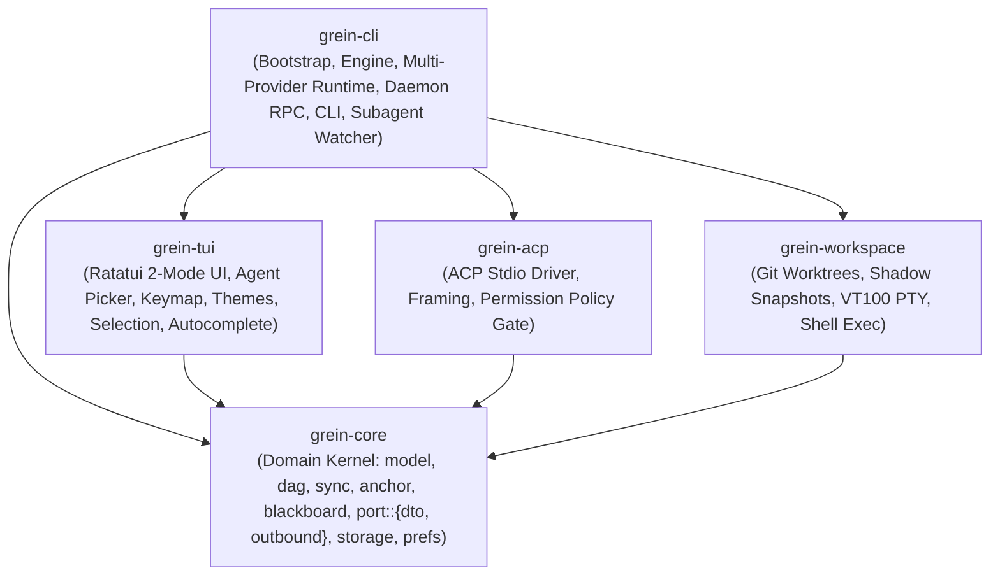
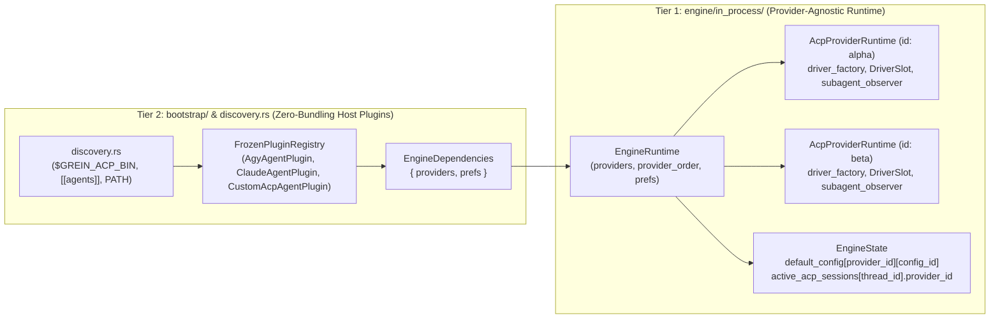
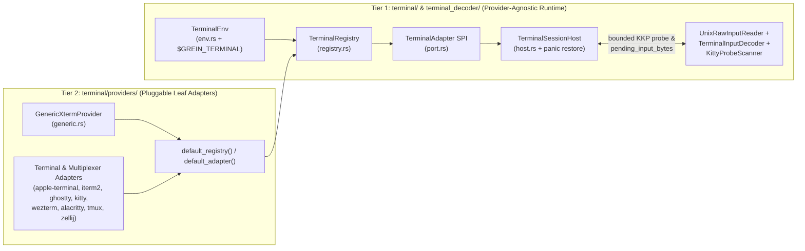
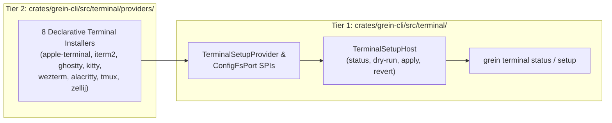

# Grein Architecture

> Authoritative architectural reference for the 5-crate **grein** workspace: hexagonal ports and drivers, constructor dependency injection, multi-provider ACP runtime isolation, zero-bundling typestate plugin bootstrap, client-daemon JSON-RPC 2.0 transport, and SQLite persistence.
> See also: [`README.md`](../README.md) · [`FEATURES.md`](./FEATURES.md) · [`KEYBINDINGS.md`](./KEYBINDINGS.md)

---

## 1. 5-Crate Workspace & Dependency Inversion

The workspace (`Cargo.toml`) is organized into five crates with strict inward dependency inversion toward `grein-core`:



### Crate Responsibilities & Dependency Boundaries

| Crate | Path | Depends On (Workspace) | Primary Responsibility |
| :--- | :--- | :--- | :--- |
| **`grein-core`** | [`crates/grein-core`](../crates/grein-core) | *(none — zero sibling or UI/async runtime deps)* | Pure-tree DAG domain (`model`, `dag`, `sync`, `anchor`, `blackboard`, `error`), shared DTOs & outbound persistence/codec traits (`port::{dto, outbound}`), SQLite DAG storage (`storage::sqlite`), and global preferences (`prefs`) |
| **`grein-acp`** | [`crates/grein-acp`](../crates/grein-acp) | `grein-core` | ACP v1 protocol framing/types, `AgentDriver` / `AgentDriverFactory` SPI, `AcpStdioDriver` / `StdioAgentDriverFactory`, and `PermissionPolicyPort` / `PolicyGate` |
| **`grein-workspace`** | [`crates/grein-workspace`](../crates/grein-workspace) | `grein-core` | Branch-named Git worktrees (`allocator`, `worktrees`, `git`, `git_status`), non-Git `.grein/shadow/` copy-on-write snapshots (`shadow`, `diff`), environment detection (`environment`), workspace file enumeration (`files`), interactive VT100 PTY (`pty_session`), and bounded shell execution (`shell`) |
| **`grein-tui`** | [`crates/grein-tui`](../crates/grein-tui) | `grein-core` | Ratatui 2-mode (`WRITE` / `MANAGE`) application state (`app`), runner loop (`runner`), rendering (`render`), `AgentPickerModal` (`app/agent_picker.rs`, `render/agent_picker.rs`), 3-tier autocomplete (`autocomplete`), customizable `Keymap` (`keymap`), 16 theme presets (`theme`), pane-scoped selection (`selection`), Two-Tier Runtime Terminal Engine (`terminal`, `terminal_decoder`), `ClipboardPort`, `PagerRunner`, `TuiServices`, and `TuiEnginePort` / `PreferencesPort` |
| **`grein-cli`** | [`crates/grein-cli`](../crates/grein-cli) | `grein-core`, `grein-acp`, `grein-workspace`, `grein-tui` | Unified `grein` binary: composition root (`bootstrap`), host discovery (`discovery.rs`), typestate `PluginRegistry`, pairwise adapters (`bootstrap/adapter`), segregated inbound engine ports (`engine/ports.rs`), provider-agnostic `InProcessEngine` (`engine/in_process/`), `UnixSocketEngineClient`, Unix socket daemon (`daemon.rs`), `SubagentWatcher`, Two-Tier Host Terminal Setup Engine (`terminal/`), headless commands, and `doctor` |

Notice that `grein-core` uses only synchronous foundational crates (`chrono`, `rusqlite`, `serde`, `serde_json`, `thiserror`, `tracing`, `uuid`) and does **not** depend on `tokio`, `ratatui`, `crossterm`, `grein-acp`, `grein-workspace`, or `grein-tui`. Neither `grein-tui`, `grein-acp`, nor `grein-workspace` depends on any sibling outer crate.

---

## 2. Hexagonal `port` / `adapter` / `driver` / `plugin` Triad

**grein** separates business orchestration from infrastructure I/O through three layers:

1. **Inbound & Outbound Ports** define capability contracts (`async_trait` or synchronous traits) over shared `grein_core::port::dto` types.
2. **App-Operated Drivers** implement outbound ports against concrete I/O backends (SQLite, stdio ACP processes, Git CLI, Unix PTYs, filesystem shadow snapshots, OS clipboards, pagers).
3. **Pairwise Bridges & Plugins** (`crates/grein-cli/src/bootstrap/`) discover host capabilities and assemble drivers into `InProcessEngine` and `grein-tui`.

### Inbound Ports

#### Engine Inbound Ports (`crates/grein-cli/src/engine/ports.rs`)

Instead of a monolithic RPC interface, `GreinEngine` composes seven Interface-Segregation-Principle (ISP) traits:

| Port Trait | Responsibility |
| :--- | :--- |
| **`ThreadUseCasePort`** | `ensure_main_thread`, `fork_thread`, `fork_thread_with_title`, `fork_thread_with_provider`, `create_root_thread`, `create_root_thread_in_cwd`, `create_agent_thread`, `rename_thread`, `list_threads`, `get_transcript`, `get_thread_transcript`, `merge_thread`, `merge_thread_with_summary`, `snapshot`, `thread_metadata`, `delete_thread` |
| **`AgentTurnPort`** | `send_turn`, `send_turn_for_thread`, `resolve_permission`, `cancel_turn`, `agent_metadata`, `agent_options`, `set_agent_config`, `list_agent_providers`, `switch_thread_provider` |
| **`ShellUseCasePort`** | `run_shell_command` (inline `!cmd` execution) |
| **`TerminalPtyUseCasePort`** | `create_terminal`, `pty_write`, `pty_resize`, `pty_snapshot`, `pty_scroll`, `pty_restart` |
| **`WorktreeUseCasePort`** | `ensure_thread_worktree`, `list_worktrees`, `switch_thread_worktree`, `remove_worktree`, `worktree_diff_preview`, `prune_worktrees` |
| **`AutocompleteContextPort`** | `list_recent_user_prompts`, `list_workspace_files` |
| **`EngineEventPort`** | `ping`, `subscribe_events` (`mpsc::UnboundedReceiver<EngineStreamEvent>`) |

- **`GreinEngine`** is the blanket supertrait combining all seven traits (`+ Send + Sync`), with `DaemonEngine` retained as a backwards-compatible supertrait alias.
- Three concrete types implement all seven traits: `InProcessEngine` (local execution), `UnixSocketEngineClient` (remote daemon Unix socket), and `EngineClient` (thin `Arc<dyn GreinEngine>` wrapper).

#### TUI Inbound Ports (`crates/grein-tui/src/engine_port.rs`)

- **`TuiEnginePort`**: Defines the TUI-facing async engine boundary (`hydrate_session`, `send_turn`, `fork_thread`, `fork_branch`, `fork_branch_with_provider`, `merge_thread`, `merge_thread_with_summary`, `resolve_permission`, `cancel_turn`, `run_shell_command`, `delete_thread`, `thread_metadata`, `create_root`, `create_root_in_cwd`, `create_agent_thread`, `rename_thread`, `agent_options`, `set_agent_config`, `list_agent_providers`, `switch_thread_provider`, PTY lifecycle methods, worktree methods, preference persistence methods, autocomplete context queries, and `subscribe_events`).
- **`PreferencesPort`**: Standalone async preferences SPI (`load_preferences`, `save_theme_preference`, `save_keybinding_preference`, `remove_keybinding_preference`, `save_ui_pref`). Injected into `App` via `TuiServices::preferences` (defaulting to `NoopPreferencesPort` inside standalone `App::new()`, or bridged in `runner/mod.rs` to `EnginePreferencesBridge` delegating to `TuiEnginePort` when `!app.services.has_custom_preferences()`). When `AppAction::SaveDefaultAgentProvider` is dispatched (`runner/dispatch.rs`), the runner persists `("ui", "default_agent_provider")` strictly through `PreferencesPort::save_ui_pref` before refreshing `list_agent_providers()`.

All shared DTOs (`HydratedSession`, `HydratedThread`, `HydratedTurn`, `ThreadSummary`, `TranscriptEntry`, `ThreadMeta`, `AgentProviderInfo`, `WorktreeEntry`, `PtyScreenSnapshot`, `PtyCell`, `PtyColor`, `PtyMouseMode`, `PtyMouseEncoding`, `SubagentSnapshot`, `SubagentStatus`, `AgentConfigOption`, `AgentConfigChoice`, `AgentSlashCommand`, `AgentOptionsSnapshot`, `AgentMetaEntry`, `UserPreferencesSnapshot`, `EngineControlEvent`, `EngineStreamEvent` / `TuiEngineEvent`) live in [`crates/grein-core/src/port/dto.rs`](../crates/grein-core/src/port/dto.rs) and are re-exported into `grein-tui::engine_port` and `grein-cli::engine::types`. Specifically:
- **`AgentProviderInfo`**: Carries `id`, `plugin_id`, `display_name`, `kind`, `available`, `executable`, `is_default`, and `install_hint` so the UI and headless clients remain decoupled from host plugin types.
- **Provider Attribution Fields**: `ThreadMeta`, `ThreadSummary`, and `HydratedThread` each carry `agent_provider: Option<String>` (with `#[serde(default)]` on `ThreadMeta`/`HydratedThread` and `#[serde(default, skip_serializing_if = "Option::is_none")]` on `ThreadSummary` for wire backwards compatibility).

### Outbound Ports & App-Operated Drivers

| Crate | Outbound Port | Concrete Driver(s) | Underlying Mechanism |
| :--- | :--- | :--- | :--- |
| `grein-core` | `SessionRepository` (+ `DagStorage`) | `SqliteStorage` (`SqliteDagStorage`) | SQLite WAL store in `.grein/session.db` (`storage/sqlite/{mod,threads,nodes}.rs`), including `update_thread_agent_provider` |
| `grein-core` / `grein-cli` | `PreferenceRepository` | `UserPrefsStore`, `LazyPrefsRepository` | SQLite WAL store in `~/.config/grein/grein.db` (defers file creation until write) |
| `grein-core` | `SettingsCodec` | `TomlSettingsCodec`, `JsonSettingsCodec` | TOML and JSON preference/theme import & export codecs |
| `grein-acp` | `AgentDriver` / `AgentDriverFactory` | `AcpStdioDriver` / `StdioAgentDriverFactory` | JSON-RPC 2.0 stdio subprocesses (`agy acp --stdio`, `claude-agent-acp` / `claude-code-acp`, `claude --acp`, custom) |
| `grein-acp` | `PermissionPolicyPort` | `PolicyGate` | Evaluates & remembers `AllowOnce`, `AlwaysThread`, `AlwaysSession`, `Deny` |
| `grein-workspace` | `WorkspaceIsolationPort` | `GitWorktreeDriver`, `ShadowCopyIsolator` | Branch-named `.grein/worktrees/` or copy-on-write `.grein/shadow/` |
| `grein-workspace` | `GitInspectorPort` | `GitCliInspector` | `git worktree list`, `git status`, `git ls-files` / workspace file discovery |
| `grein-workspace` | `TerminalPtyHandle` / `PtySpawnerPort` | `InteractivePtySession` / `UnixPtySpawner` | POSIX PTY pair (`posix_openpt`), `vt100` 1,000-row buffer, query scanner, `OSC 7` / OS cwd |
| `grein-workspace` | `ShellExecutorPort` | `PtyShellExecutor` | One-shot PTY command execution with 30 s timeout & 64 KiB cap |
| `grein-cli` | `SubagentObserverPort` | `SubagentWatcher` (`AntigravityBrainObserver`), `NoopSubagentObserver` | Read-only tailer over `~/.gemini/antigravity-cli/brain` child transcripts |
| `grein-tui` | `ClipboardPort` (`ClipboardWriterBackend`, `ClipboardReaderBackend`) | `ChainedClipboardDriver` (`Osc52Backend`, `CommandClipboardBackend`) | `pbcopy` / `wl-copy` / `xclip` / `xsel` + `OSC 52` (`tmux`-aware) |
| `grein-tui` | `PagerRunner` | `DefaultPagerRunner` | Pipes diff payloads to `$PAGER` (default `less -R`) |

### Pairwise Bridges (`bootstrap/adapter/` & `engine/rpc.rs`)

- **`EngineClientPort<E>`** ([`crates/grein-cli/src/bootstrap/adapter/tui_to_engine.rs`](../crates/grein-cli/src/bootstrap/adapter/tui_to_engine.rs) & [`crates/grein-cli/src/bootstrap/adapter/providers.rs`](../crates/grein-cli/src/bootstrap/adapter/providers.rs)): Adapts any `E: GreinEngine + Send + Sync + 'static` plus an `Arc<dyn PreferenceRepository>` into `TuiEnginePort`. Handles `InitialSessionMode::Terminal` vs `InitialSessionMode::Agent` hydration, synthesizes fallback events when no live stream is attached, reconciles synchronous turn RPC errors with async `EngineStreamEvent::Error` emissions via `suppressed_sync_errors` / `buffered_sync_errors`, and bridges multi-provider operations:
  - `list_agent_providers` degrades `-32601` / unsupported engine errors (`is_unsupported_engine_error`) to `Ok(Vec::new())`.
  - `create_agent_thread` falls back to `create_root_thread_in_cwd` / `create_root_thread` on unsupported engines when `parent_thread_id.is_none() && agent_provider.is_none()`.
  - `fork_branch_with_provider` falls back to `fork_thread_with_title` when `agent_provider.is_none()`.
  - `switch_thread_provider` emits `ThreadMetadataUpdated`, `AgentConfigUpdated`, and `AgentCommandsUpdated` when no live stream is attached.
- **`LazyPrefsRepository`** ([`crates/grein-cli/src/bootstrap/adapter/mod.rs`](../crates/grein-cli/src/bootstrap/adapter/mod.rs)): Wraps `UserPrefsStore` behind lazy on-disk opening so read-only queries (`theme()`, `keybindings()`, `ui_prefs()`, `get("ui", "default_agent_provider")`) return empty/default values without touching disk when `grein.db` does not yet exist.
- **`dispatch_json_rpc`** ([`crates/grein-cli/src/engine/rpc.rs`](../crates/grein-cli/src/engine/rpc.rs)): Bridges newline-delimited JSON-RPC 2.0 requests from `daemon.rs` and `standalone.rs` to `&dyn GreinEngine`.

---

## 3. Constructor DI, Zero-Bundling Plugins & Multi-Provider ACP Architecture

**grein** enforces a zero-bundling host plugin model across two strict architectural tiers:

- **Zero-Bundling Packaging (`flake.nix`):** [`flake.nix`](../flake.nix) builds `grein` hermetically (`buildInputs = [ pkgs.sqlite ]`, `nativeBuildInputs = [ pkgs.pkg-config ]`, `nativeCheckInputs = [ pkgs.python3 pkgs.git ]`) without bundling external ACP agent binaries (`agy`, `claude`, `claude-agent-acp`, `claude-code-acp`). Host plugins are discovered at runtime and missing providers remain visible with optional `install_hint` guidance.
- **Tier 2 (`bootstrap/` + `discovery.rs`):** Discovers host binaries/TOML declarations, wraps each provider in an `AgentPlugin` inside `FrozenPluginRegistry`, and injects `RegisteredAgentProvider` descriptors plus `PreferenceRepository` into `EngineDependencies`.
- **Tier 1 (`engine/in_process/`):** `EngineRuntime` has zero hardcoded knowledge of `agy`, `claude`, or custom binaries; every provider runs inside an isolated `AcpProviderRuntime` keyed by `provider_id`.



### Tier 1: Provider-Agnostic `EngineRuntime` & `AcpProviderRuntime` Isolation

- **`EngineDependencies`** ([`crates/grein-cli/src/engine/in_process/mod.rs`](../crates/grein-cli/src/engine/in_process/mod.rs)): Accepts `storage`, `agent_factory`, `policy: Option<Arc<dyn PermissionPolicyPort>>`, `pty_spawner`, `workspace`, `git_inspector`, `shell`, `subagent_observer`, `cwd`, `acp_config`, **`providers: Vec<RegisteredAgentProvider>`**, and **`prefs: Option<Arc<dyn PreferenceRepository>>`**.
  - `build_engine_dependencies` ([`crates/grein-cli/src/bootstrap/mod.rs`](../crates/grein-cli/src/bootstrap/mod.rs)) populates `providers` exclusively from `FrozenPluginRegistry::agent_plugins()` and injects `prefs: Some(build_prefs_repository(config))` (`LazyPrefsRepository`).
  - `EngineDependencies::for_storage` passes `providers: Vec::new()` and `prefs: None`; when `deps.providers` is empty and `deps.acp_config` is `Some(cfg)`, `build_provider_registry` ([`crates/grein-cli/src/engine/in_process/providers.rs`](../crates/grein-cli/src/engine/in_process/providers.rs)) synthesizes a fallback `"default"` (`agent.default`) `AcpProviderRuntime` from `deps.agent_factory` and `deps.subagent_observer`.
- **Per-Provider `AcpProviderRuntime` Isolation** (`engine/in_process/providers.rs`):
  - Stores provider metadata (`id`, `plugin_id`, `display_name`, `kind`, `available`, `executable`, `args`, `auth_method`, `install_hint`), **`driver_factory: Arc<dyn AgentDriverFactory>`**, **`subagent_observer: Arc<dyn SubagentObserverPort>`**, and **`acp_driver: AsyncMutex<Option<DriverSlot>>`** (`DriverSlot { driver: Arc<dyn AgentDriver>, generation: u64 }`).
  - Each provider lazily spawns, initializes, authenticates, monitors (`current_driver_if_running`, `invalidate_driver_if_dead`), closes/cancels sessions (`close_session_if_running`, `cancel_session`), and shuts down (`shutdown_driver`) its own ACP subprocess independently — allowing concurrent sibling threads on different providers in the same workspace without cross-talk.
  - At `InProcessEngine::with_dependencies`, every provider's `subagent_observer` attaches an emitter to `tui_subscribers`; thread deletion clears the thread across all observers (`clear_thread_from_all_observers`) and engine shutdown drains all provider drivers and observers (`shutdown_all_drivers`, `shutdown_all_observers`).
- **Session & Config Isolation (`EngineState` & `ActiveAcpSession`)**:
  - `ActiveAcpSession` records `provider_id: String`, `session_id: String`, `driver_gen: u64`, `model`, `mode`, `config_options`, `available_commands`, `pending_landmarks`, `cmd_tx`, and `listener_handle`. Sessions are evicted and re-established whenever `s.provider_id != provider.id || s.driver_gen != driver_gen || s.cmd_tx.is_closed()`.
  - `EngineState::default_config: HashMap<String, HashMap<String, String>>` is partitioned as `HashMap<provider_id, HashMap<config_id, value>>`: setting a default via `set_agent_config(..., set_default = true)` stores it under `resolved_provider_id` so one provider's default model/mode never leaks onto another provider.
  - `EngineState::pending_thread_config: HashMap<String, HashMap<String, String>>` stores per-thread pending overrides and is cleared when `switch_thread_provider` changes a thread's provider, alongside `reset_thread_acp_session` (which clears `threads.acp_session_id` in SQLite and closes the previous provider's session).
- **Provider Resolution & Default Precedence** (`resolve_runtime_for_thread` & `effective_available_default_provider`):
  1. Explicit `thread.agent_provider` resolves case-insensitively across `id` → `plugin_id` → `display_name` (`find_provider`). Unregistered IDs return `EngineError::InvalidParams`; registered unavailable providers (`!p.available`) return `EngineError::InvalidParams` including `install_hint` when present.
  2. When `thread.agent_provider` is `None`, `effective_available_default_provider()` checks `prefs.get("ui", "default_agent_provider")` (requiring `p.available`), then falls back to `default_provider_id` / first available entry in `provider_order`.
  - `ensure_main_thread`, `create_agent_thread` (when `agent_provider` is omitted), and `fork_thread_with_provider` (inheriting parent's `agent_provider` when omitted or overriding when provided) persist the resolved `agent_provider` on the created thread.
- **`TuiServices`** (`crates/grein-tui/src/app/types.rs`): Injects `clipboard: Arc<dyn ClipboardPort>`, `pager: Arc<dyn PagerRunner>`, `preferences: Arc<dyn PreferencesPort>`, and `terminal: Arc<dyn TerminalAdapter>` into `App::with_services` / `run_with_engine_and_services` (defaulting to `ChainedClipboardDriver::default()`, `DefaultPagerRunner::new()`, `NoopPreferencesPort`, and `terminal::providers::default_adapter(&TerminalEnv::from_env())`).

### Tier 2: Discovery Priority, `AgentPlugin` Metadata & Typestate `PluginRegistry`

`PluginRegistry<State>` (`crates/grein-cli/src/bootstrap/registry.rs`) enforces registration-before-execution at compile time using zero-sized `Building` and `Frozen` marker types:

```mermaid
stateDiagram-v2
    [*] --> Building : PluginRegistryBuilder::new()
    Building --> Building : register_workspace_plugin() / register_agent_plugin()<br/>(validates non-empty, unique plugin id)
    Building --> Frozen : freeze() -> FrozenPluginRegistry
    Frozen --> Running : start_all() (in registration order;<br/>rolls back started plugins on failure)
    Running --> Stopped : shutdown_all() (reverse LIFO drain)
    Stopped --> [*]
```

#### Discovery Priority & Configuration Precedence (`crates/grein-cli/src/discovery.rs` & `bootstrap/mod.rs`)

1. **`$GREIN_ACP_BIN` Override:** If set and empty/whitespace, `BootstrapConfig::acp_explicitly_disabled()` disables ACP agent registration; if non-empty, `CustomAcpAgentPlugin::from_env` registers `agent.custom.env` using `$GREIN_ACP_ARGS` and `$GREIN_ACP_AUTH_METHOD`.
2. **`[[agents]]` / `[agent]` TOML Configuration (`resolve_agents_configuration`):** Parses `name`, `kind`, `executable` / `path`, and `command` tables; when non-empty, overrides `$PATH` discovery.
3. **`$PATH` Discovery (`discover_acp_agents`):** Scans `DISCOVERY_CANDIDATES` candidate-first across every `$PATH` directory:
   - `AcpAgentKind::Agy`: `["agy"]`
   - `AcpAgentKind::Claude`: `["claude-agent-acp", "claude-code-acp", "claude"]` — native ACP adapters (`claude-agent-acp` first, then `claude-code-acp`) anywhere on `$PATH` take precedence over an earlier `claude` CLI binary. `claude_acp_args` returns `[]` for `CLAUDE_NATIVE_ACP_STEMS` (`claude-agent-acp`, `claude-code-acp`) and `["--acp"]` for `claude`.
4. **Always-Registered Built-Ins:** `build_registry` always registers both `AgyAgentPlugin` (`agent.agy`) and `ClaudeAgentPlugin` (`agent.claude`) even when absent from `$PATH` (`executable_path = None`, `available: false`) so `list_agent_providers` can surface readiness and `install_hint` metadata, followed by any extra resolved entries (`CustomAcpAgentPlugin::from_discovered`).

#### `AgentPlugin` Metadata & Registered Plugins (`bootstrap/plugins.rs` & `bootstrap/registry.rs`)

`AgentPlugin` extends `LifecyclePlugin` with `kind() -> AcpAgentKind`, `short_name() -> String`, `display_name() -> String`, `install_hint() -> Option<String>`, `executable_path() -> Option<&Path>`, `is_available() -> bool`, `driver_factory()`, `acp_backend_config(cwd)`, and `subagent_observer()`. `FrozenPluginRegistry::agent_plugin_by_name` resolves queries case-insensitively by `id`, `short_name`, or `kind_from_label`.

| Plugin Struct | Plugin ID | `short_name` / `display_name` | Trait | Role & Metadata |
| :--- | :--- | :--- | :--- | :--- |
| **`GitWorktreePlugin`** | `workspace.git_worktree` | — | `WorkspacePlugin` | Selected when `EnvironmentDetector` detects `WorkspaceEnvironment::GitRepository`; provides `GitWorktreeDriver` + `GitCliInspector` |
| **`ShadowCopyPlugin`** | `workspace.shadow_copy` | — | `WorkspacePlugin` | Selected when `EnvironmentDetector` detects `WorkspaceEnvironment::NonGitDirectory`; provides `ShadowCopyIsolator` + `GitCliInspector` |
| **`CustomAcpAgentPlugin`** | `agent.custom.env` / `agent.custom.<idx>.<stem>` | `<stem>` / `Custom (<stem>)` | `AgentPlugin` | Wraps `$GREIN_ACP_BIN` or custom `[[agents]]` / extra discovered entries; `install_hint: None`; pairs with `StdioAgentDriverFactory` + `NoopSubagentObserver` |
| **`AgyAgentPlugin`** | `agent.agy` | `agy` / `Antigravity (agy)` | `AgentPlugin` | Discovered `agy` (`acp --stdio`, default `oauth-personal` auth); `install_hint: None`; pairs with `StdioAgentDriverFactory` + `AntigravityBrainObserver` (`SubagentWatcher`), shutting down the watcher on `shutdown()` |
| **`ClaudeAgentPlugin`** | `agent.claude` | `claude` / `Claude Code` | `AgentPlugin` | Discovered `claude-agent-acp` → `claude-code-acp` → `claude` (`[]` vs `["--acp"]`); `install_hint: Some("nix shell --impure nixpkgs#claude-agent-acp")`; pairs with `StdioAgentDriverFactory` + `NoopSubagentObserver` |

`run_cli` builds `BootstrapConfig::from_env`, constructs and freezes the registry via `build_registry(&config)`, runs `registry.start_all().await`, dispatches the active CLI subcommand (standalone TUI, daemon, attach, headless inspection, `terminal`, `keys`, `doctor`, settings/theme), and guarantees `registry.shutdown_all().await` before returning.

---

## 4. Two-Tier Terminal Architecture (Runtime & Host Setup)

Terminal integration follows the Universal Two-Tier Component Architecture across both the interactive TUI runtime (`grein-tui`) and host configuration CLI (`grein-cli`), keeping Tier 1 lifecycle hosts, registries, and byte decoders completely decoupled from concrete Tier 2 terminal/multiplexer implementations.

### Two-Tier Runtime Terminal Engine (`crates/grein-tui/src/terminal/` & `terminal_decoder/`)



- **Tier 1 SPI & Environment Model ([`crates/grein-tui/src/terminal/port.rs`](../crates/grein-tui/src/terminal/port.rs), [`env.rs`](../crates/grein-tui/src/terminal/env.rs)):**
  - **`TerminalAdapter`**: Defines `kind() -> TerminalKind`, `display_name()`, `matches(&TerminalEnv) -> Option<u8>`, `capabilities(&TerminalEnv) -> TerminalCapabilities` (`ColorCapability::{TrueColor, Xterm256}`, `KeyboardProtocolPolicy::{None, KittyDisambiguate, ModifyOtherKeys, BoundedProbeKitty { timeout_ms }}`, `osc52_clipboard`, `focus_events`, `bracketed_paste`), `protocol_plan(&TerminalEnv, &TerminalSessionOptions) -> TerminalProtocolPlan`, `encode_osc52(&str) -> String`, and `diagnostic_hints(&TerminalEnv) -> Vec<TerminalHint>`.
  - **`TerminalKind`**: Covers `AppleTerminal` (`apple-terminal`), `ITerm2` (`iterm2`), `Ghostty` (`ghostty`), `Kitty` (`kitty`), `WezTerm` (`wezterm`), `Alacritty` (`alacritty`), `Tmux` (`tmux`), `Zellij` (`zellij`), and `GenericXterm` (`generic-xterm`) with kebab-case `FromStr`/`Display` parsing.
  - **`TerminalEnv`**: Captures `TERM`, `TERM_PROGRAM`, `TERM_PROGRAM_VERSION`, `COLORTERM`, `KITTY_WINDOW_ID`, `GHOSTTY_RESOURCES_DIR`, `WEZTERM_EXECUTABLE`, `TMUX`, `ZELLIJ`, `ZELLIJ_SESSION_NAME`, `STY`, locale (`LC_ALL`/`LC_CTYPE`/`LANG`), and `$GREIN_TERMINAL` (`grein_terminal_override`).
- **Tier 1 Registry & Session Host ([`registry.rs`](../crates/grein-tui/src/terminal/registry.rs), [`host.rs`](../crates/grein-tui/src/terminal/host.rs)):**
  - **`TerminalRegistry`**: Holds `Vec<Arc<dyn TerminalAdapter>>`, honoring `$GREIN_TERMINAL` (`resolve_by_kind`) before selecting the highest-scoring `matches(&TerminalEnv)` candidate (`resolve` / `resolve_or_err`), with zero concrete provider imports.
  - **`TerminalSessionHost`**: Enters raw mode, writes alternate-screen/bracketed-paste/mouse-capture/focus-change sequences plus `TerminalProtocolPlan::enter_bytes`, executes bounded KKP probing when `probe_kitty_timeout_ms` is set (clearing `enter_bytes`/`leave_bytes` when unsupported and preserving early input in `take_pending_input_bytes()`), tracks `ActiveTerminalModes`, installs a global panic-restore hook, and guarantees `leave_bytes` + mode teardown flush before `disable_raw_mode` (`restore_with_writer`). `run_with_engine_and_services` (`lib.rs`) and `TerminalGuard` (`runner/mod.rs`) wrap `TerminalSessionHost`.
- **Pure-Byte Unix Input Decoder ([`crates/grein-tui/src/terminal_decoder/`](../crates/grein-tui/src/terminal_decoder/mod.rs)):**
  - **`TerminalInputDecoder`** (`parser.rs`): Byte-at-a-time state machine (`Ground`, `EscPending`, `Csi`, `Ss3`, `Delimited`, `X10Mouse`, `BracketedPaste`, `Utf8`) producing `DecodedInput { event: Event, raw_bytes: Vec<u8> }`. Decodes `modifyOtherKeys` format 2 (`CSI 27;<mod>;<code>~`), rxvt Shift/Ctrl arrows (`CSI a..d`, `SS3 a..d`), standard/modified `SS3` sequences (`\x1bO2A`, `\x1bO1;2C`), leading-semicolon `CSI` params (`\x1b[;2A`), Kitty Keyboard Protocol (`CSI <cp>[:<shifted>];<mod>[:<kind>]u` with Press/Repeat/Release, functional/keypad/media/modifier codepoints), SGR/X10 mouse events, bracketed paste (`\x1b[200~...\x1b[201~`), focus events, and UTF-8/`Alt+char` chords.
  - **`KittyProbeScanner`** (`parser.rs`): Scans `CSI ?<flags>u` (`KittyFlags(u8)`) and Primary Device Attributes `CSI ?...c` (`PrimaryDeviceAttributes`) while preserving interleaved user keystrokes in `buffered_bytes`.
  - **`UnixRawInputReader`** (`unix_reader.rs`): Uses `libc::poll` + `libc::read` with `25 ms` `ESC_IDLE_TIMEOUT` to distinguish lone `Esc` from split-packet escape sequences, `SA_RESTART`-free `SIGWINCH` resize wakeup, `push_initial_bytes` replay, and `probe_kitty_keyboard(timeout_ms)` sending `\x1b[?u\x1b[c` bounded by `DA1` or timeout.
- **Tier 2 Leaf Providers (`crates/grein-tui/src/terminal/providers/`):**
  - Concrete `TerminalAdapter` implementations (including baseline `GenericXtermProvider` in `generic.rs` and app/multiplexer-specific adapters) wired at the composition boundary via `default_registry()` / `default_adapter(&TerminalEnv)`.

### Two-Tier Host Terminal Setup Engine (`crates/grein-cli/src/terminal/`)



- **Tier 1 Setup SPIs & Host (`crates/grein-cli/src/terminal/`):**
  - **`TerminalSetupProvider` SPI:** Abstracts terminal/multiplexer host config inspection, readiness evaluation, and idempotent apply/revert planning behind a trait boundary.
  - **`ConfigFsPort` SPI:** Abstracts host configuration filesystem reads, writes, and backups so dry-run previews and integration tests execute deterministically without mutating real user config directories.
  - **`TerminalSetupHost`:** Resolves `<app|auto>` providers solely through `TerminalSetupProvider` and executes `grein terminal status [--json]` and `grein terminal setup <app|auto> [--dry-run | --apply | --revert] [--json]` without referencing concrete Tier 2 installer structs.
- **Tier 2 Declarative Installers (`crates/grein-cli/src/terminal/providers/`):**
  - Implements declarative configuration inspection, backups, apply rules, and revert rules across all 8 supported terminals and multiplexers (`apple-terminal`, `iterm2`, `ghostty`, `kitty`, `wezterm`, `alacritty`, `tmux`, `zellij`).

---

## 5. Daemon & Standalone JSON-RPC 2.0 Transport

**grein** supports three runtime execution topologies over the same `GreinEngine` interface:

1. **In-process TUI (`grein` / `grein standalone`):** `EngineClientPort` holds `Arc<InProcessEngine>` directly in-memory against `.grein/session.db`.
2. **Embedded standalone channel (`crates/grein-cli/src/standalone.rs`):** `run_standalone_with_engine` serves `InProcessRequest` (`Ping`, `SendTurn`, `ForkThread`, `ListThreads`, `JsonRpc`) over bounded `tokio::sync::mpsc` channels for programmatic callers (`InProcessClient`).
3. **Daemon + Attach (`grein daemon` + `grein attach`):** `run_daemon_with_engine` (`daemon.rs`) binds a Unix domain socket (`.grein/daemon.sock` or `--socket`), accepts concurrent socket connections, and spawns a Tokio task per stream.

### Shared vs. Dedicated Connections (`UnixSocketEngineClient`)

Long-running agent turns (`session.send_turn` / `session.send_thread_turn`) stay open waiting for turn completion. To prevent turn execution from head-of-line blocking interactive PTY I/O, metadata refreshes, provider queries, or cancellation, `UnixSocketEngineClient` (`crates/grein-cli/src/engine/socket_client.rs`, `socket_client_ports.rs`) splits traffic across three connection paths:

- **Shared `io: AsyncMutex<SocketIo>` (`call` / `call_typed`):** Used for `session.ping`, `session.ensure_main_thread`, `session.fork_thread`, `session.list_threads`, `session.get_transcript`, `session.merge_thread`, `session.send_turn`, `session.send_thread_turn`, `session.agent_metadata`, `session.agent_options`, `session.set_agent_config`, and `session.shell`.
- **Dedicated per-call `UnixStream` (`call_dedicated` / `call_dedicated_typed`):** Opens a fresh connection bypassing `self.io` for `session.create_root_thread`, `session.rename_thread`, `session.thread_metadata`, `session.delete_thread`, `session.list_agent_providers`, `session.switch_thread_provider`, `permissions.resolve`, `session.cancel`, all `TerminalPtyUseCasePort` methods (`create_terminal`, `pty_write`, `pty_resize`, `pty_snapshot`, `pty_scroll`, `pty_restart`), all `WorktreeUseCasePort` methods (`ensure_thread_worktree`, `list_worktrees`, `switch_thread_worktree`, `remove_worktree`, `worktree_diff_preview`, `prune_worktrees`), and `AutocompleteContextPort` methods (`list_recent_prompts`, `list_workspace_files`).
  - **Stale-Daemon `-32601` Fallback:** `UnixSocketEngineClient::parse_rpc_response` (`is_optional_stale_empty_list_rpc`) degrades `-32601` (`Method not found`) on `session.list_agent_providers` / `list_agent_providers` (and `list_recent_prompts` / `list_workspace_files`) to `[]`, allowing newer TUI clients to attach cleanly to older daemons without multi-provider support.
- **Dedicated event stream (`session.subscribe_events`):** Sends `{"jsonrpc":"2.0","id":1,"method":"session.subscribe_events","params":{}}`, receives `{"result":{"subscribed":true}}`, and streams newline-delimited `EngineStreamEvent` frames continuously into the client channel.

### JSON-RPC 2.0 Methods (`crates/grein-cli/src/engine/rpc.rs`)

| Primary Method | Accepted Alias | Purpose |
| :--- | :--- | :--- |
| `session.ping` | — | Health check (`{"pong": true}`) |
| `session.ensure_main_thread` | — | Return or initialize primary root agent thread |
| `session.create_root_thread` | `session.create_root` | Create root or sibling agent thread (`title`, `cwd`, `parent_thread_id`, `agent_provider` / `provider` optional; routes to `create_agent_thread` when `parent_thread_id` or provider is supplied) |
| `session.fork_thread` | — | Fork branch from `parent_node_id` / `source_thread_id` (`title` and `agent_provider` / `provider` optional; routes to `fork_thread_with_provider` when provider is supplied) |
| `session.rename_thread` | — | Update or clear thread `custom_name` |
| `session.list_threads` | — | List all `ThreadSummary` records |
| `session.thread_metadata` | — | Fetch `Vec<ThreadMeta>` (`kind`, `cwd`, `git_branch`, `git_dirty`, `agent_provider`, parent linkage) |
| `session.delete_thread` | — | Delete thread and return `next_active_thread_id` |
| `session.get_transcript` | — | Fetch trunk transcript (`thread_id` optional) |
| `session.send_turn` | — | Send prompt (`thread_id` optional) |
| `session.send_thread_turn` | — | Send prompt to explicit `thread_id` |
| `session.merge_thread` | — | Join branch into parent with optional `summary` |
| `session.cancel` | — | Cancel active ACP turn on `thread_id` |
| `session.shell` | — | Execute bounded `!cmd` shell command on `thread_id` |
| `session.agent_metadata` | — | Fetch model, mode, options, and commands across active ACP sessions |
| `session.agent_options` | — | Fetch `AgentOptionsSnapshot` for `thread_id` |
| `session.set_agent_config` | — | Apply ACP `config_id`/`value` (`set_default` optional; scoped per `provider_id`) |
| `session.list_agent_providers` | `list_agent_providers` | List registered `AgentProviderInfo` records sorted with active default first (`-32601` degrades to `[]` in `UnixSocketEngineClient` & `EngineClientPort`) |
| `session.switch_thread_provider` | `switch_thread_provider` | Persist `agent_provider` (`provider` / `agent_provider` param) on `thread_id`, clear `pending_thread_config`, reset ACP session, emit `ThreadMetadataUpdated`, and return `{"provider": resolved}` |
| `permissions.resolve` | — | Resolve pending tool permission (`request_id`, `allow`) |
| `session.create_terminal` | `create_terminal` | Spawn interactive PTY terminal thread |
| `session.pty_write` | `pty_write` | Write raw input bytes to PTY |
| `session.pty_resize` | `pty_resize` | Resize PTY (`rows`, `cols`) |
| `session.pty_snapshot` | `pty_snapshot` | Capture live `PtyScreenSnapshot` |
| `session.pty_scroll` | `pty_scroll` | Scroll PTY scrollback buffer by `delta` |
| `session.pty_restart` | `pty_restart` | Restart exited PTY in persisted `cwd` |
| `session.ensure_thread_worktree` | `ensure_thread_worktree` | Allocate branch worktree or shadow directory |
| `session.list_worktrees` | `list_worktrees` | Discover worktrees across active/known repos |
| `session.switch_thread_worktree` | `switch_thread_worktree` | Attach `thread_id` to `target_path` (resetting ACP if needed) |
| `session.remove_worktree` | `remove_worktree` | Remove non-primary worktree (`force` optional) |
| `session.worktree_diff_preview` | `worktree_diff_preview` | Return git or shadow diff preview for `path` |
| `session.prune_worktrees` | `prune_worktrees` | Prune stale worktree registrations |
| `session.list_recent_prompts` | `list_recent_prompts` | Query recent user prompts for Tier 2 autocomplete |
| `session.list_workspace_files` | `list_workspace_files` | List up to 5,000 workspace files for Tier 1 autocomplete |
| `session.subscribe_events` | — | Upgrade connection to `EngineStreamEvent` push stream |

`daemon.rs` also retains legacy line-mode commands (`ping`, `send_turn:<prompt>`, `list_entries`) for backwards compatibility with minimal test clients.

---

## 6. Persistence & Modular Guardrails

### Session DAG Database (`.grein/session.db`)

Implemented in [`crates/grein-core/src/storage/sqlite/`](../crates/grein-core/src/storage/sqlite/) (`mod.rs`, `threads.rs`, `nodes.rs`), configured with:
- `PRAGMA foreign_keys = ON`
- `PRAGMA journal_mode = WAL`
- `PRAGMA busy_timeout = 5000`

Schema and idempotent `PRAGMA table_info(threads)` column migrations (including `ALTER TABLE threads ADD COLUMN agent_provider TEXT` and `SessionRepository::update_thread_agent_provider`):

| Table | Key Columns | Constraints & Indexes |
| :--- | :--- | :--- |
| **`nodes`** | `id`, `parent_id`, `role`, `content`, `created_at` | `FOREIGN KEY (parent_id) REFERENCES nodes(id) ON DELETE RESTRICT`; `idx_nodes_parent_id` |
| **`threads`** | `id`, `parent_node_id`, `anchor_id`, `active_leaf_id`, `status`, `created_at`, `title`, `acp_session_id`, `merged`, `parent_thread_id`, `kind`, `cwd`, `custom_name`, `agent_provider` | Foreign keys on `parent_node_id` & `active_leaf_id` (`ON DELETE RESTRICT`); `idx_threads_parent_node`; additive column migrations for legacy DBs (`threads.agent_provider TEXT`) |
| **`anchors`** | `id`, `level`, `title`, `slug`, `line_number`, `created_at` | Parsed Markdown heading anchors |
| **`node_anchors`** | `node_id`, `anchor_id` | Composite PK `(node_id, anchor_id)` with `ON DELETE CASCADE` |
| **`blackboard_entries`** | `id`, `key`, `value`, `kind`, `created_at` | Unique `idx_blackboard_entries_key_unique`, `idx_blackboard_entries_kind` |

### Global Preferences Store (`UserPrefsStore`)

Implemented in [`crates/grein-core/src/prefs/store.rs`](../crates/grein-core/src/prefs/store.rs) with path resolution precedence:
1. `$GREIN_CONFIG_DB` (if non-empty)
2. `$XDG_CONFIG_HOME/grein/grein.db`
3. `$HOME/.config/grein/grein.db`

Uses `PRAGMA journal_mode=WAL; PRAGMA busy_timeout=5000;` on disk and stores records in:

```sql
CREATE TABLE IF NOT EXISTS preferences (
    namespace TEXT NOT NULL,
    key TEXT NOT NULL,
    value TEXT NOT NULL,
    updated_at TEXT NOT NULL,
    PRIMARY KEY (namespace, key)
);
```

- **Namespaces:** `theme` (`name` + 24 palette slot overrides), `keybinding` (`BindableAction` canonical name → chord list), and `ui` (`sidebar_mode`, `sidebar_min_pct`, `sidebar_max_pct`, `sidebar_fixed_cols`, `sidebar_fixed_pct`, `sidebar_overflow`, `composer_autocomplete`, **`default_agent_provider`**).
  - `("ui", "default_agent_provider")` is read by `EngineRuntime::effective_available_default_provider()` via `PreferenceRepository` (`LazyPrefsRepository`) and persisted from the TUI via `PreferencesPort::save_ui_pref` (`TuiServices::preferences` / `EnginePreferencesBridge`).
- **Portability:** `TomlSettingsCodec` and `JsonSettingsCodec` power `grein settings export|import` and `grein theme export|import` with merge-patch or `--replace` transactional updates.

### Modular Discipline & Automated Contract Verification

- **`< 1,000`-Line Source Discipline:** Every `src/**/*.rs` file across all five crates stays strictly under 1,000 lines (largest production modules are `crates/grein-tui/src/render/sidebar.rs` at 897 lines and `crates/grein-tui/src/app/commands.rs` at 881 lines), with cohesive splits across `storage/sqlite/`, `engine/in_process/`, `bootstrap/`, `pty_session/`, `stdio/`, `app/`, `render/`, and `runner/`.

#### Contract & Guardrail Test Suites

| Suite / Module | Location | Verified Contracts & Invariants |
| :--- | :--- | :--- |
| **`arch_rules_test`** | [`crates/grein-cli/tests/arch_rules_test.rs`](../crates/grein-cli/tests/arch_rules_test.rs) | DIP `grein_tui` isolation (Rule 1), pure domain `rusqlite` ban (Rule 2), `TTC-004` test-double segregation (Rule 3), `< 1,000`-line source ceiling (Rule 4), `< 100`-line `main.rs` (Rule 5), and **Rule 6 (`TTC-003` Terminal Tier 1 Hosts No Concrete Providers)** forbidding `providers` or concrete provider structs (`GenericXtermProvider`, `AppleTerminalProvider`, `ITerm2Provider`, `GhosttyProvider`, `KittyProvider`, `WezTermProvider`, `AlacrittyProvider`, `TmuxProvider`, `ZellijProvider`) in `grein-tui/src/terminal/{host,registry}.rs` and `grein-cli/src/terminal/host.rs` |
| **`terminal_host_contract_test`** | [`crates/grein-tui/tests/terminal_host_contract_test.rs`](../crates/grein-tui/tests/terminal_host_contract_test.rs) | `TerminalRegistry` priority & `$GREIN_TERMINAL` override resolution, `TerminalKind` kebab-case round-trips, `TerminalSessionHost` enter/leave flush ordering before `disable_raw_mode`, and `TerminalGuard` / `TuiServices::terminal` wiring |
| **`terminal_decoder_test`** | [`crates/grein-tui/tests/terminal_decoder_test.rs`](../crates/grein-tui/tests/terminal_decoder_test.rs) | `TerminalInputDecoder` & `UnixRawInputReader`: `modifyOtherKeys` format 2, rxvt arrows, modified `SS3`, leading-semicolon `CSI`, split-packet `ESC` buffering (`25 ms` idle flush), Kitty Press/Repeat/Release & `KittyProbeScanner`, SGR/X10 mouse, bracketed paste, and `raw_bytes` preservation |
| **`hex_bootstrap_di_test`** | [`crates/grein-cli/tests/hex_bootstrap_di_test.rs`](../crates/grein-cli/tests/hex_bootstrap_di_test.rs) | Typestate `PluginRegistry` rollback/drain, `EngineDependencies` constructor DI, and `ChainedClipboardDriver` trait objects |
| **`multi_provider_acp_test`** | [`crates/grein-cli/tests/multi_provider_acp_test.rs`](../crates/grein-cli/tests/multi_provider_acp_test.rs) | `FrozenPluginRegistry` → `EngineDependencies::{providers, prefs}` injection, concurrent multi-provider turns & shutdown, per-provider `default_config` isolation, `switch_thread_provider` SQLite persistence & session reset, `("ui", "default_agent_provider")` precedence, JSON-RPC / `UnixSocketEngineClient` roundtrips, `-32601 -> []` stale fallback, and `EngineClientPort` event emission |
| **`agent_provider_picker_test`** | [`crates/grein-tui/tests/agent_provider_picker_test.rs`](../crates/grein-tui/tests/agent_provider_picker_test.rs) | `/agent` composer autocomplete & sibling creation, `A` / `:agent` / dynamic `:<provider>` palette suggestions & windowed scroll, `AgentPickerModal` rendering & `install_hint` notices, `[<provider>]` sidebar/status badges, and runner persistence of `default_agent_provider` strictly via `TuiServices::preferences` (`PreferencesPort`) |
| **`discovery_test`** | [`crates/grein-cli/tests/discovery_test.rs`](../crates/grein-cli/tests/discovery_test.rs) | `$PATH` discovery, `[[agents]]` / `[agent]` TOML parsing, malformed/missing config fallbacks |
| **Outbound & DTO contracts** | [`crates/grein-core/tests/port_contracts_test.rs`](../crates/grein-core/tests/port_contracts_test.rs), [`crates/grein-acp/tests/port_contracts_test.rs`](../crates/grein-acp/tests/port_contracts_test.rs), [`crates/grein-workspace/tests/port_contracts_test.rs`](../crates/grein-workspace/tests/port_contracts_test.rs) | `SessionRepository`, `PreferenceRepository`, `AgentDriver`, `WorkspaceIsolationPort`, `AgentProviderInfo`, and backwards-compatible DTO serde defaults |
| **Bootstrap & adapter unit suites** | [`crates/grein-cli/src/bootstrap/mod.rs`](../crates/grein-cli/src/bootstrap/mod.rs), [`registry.rs`](../crates/grein-cli/src/bootstrap/registry.rs), [`plugins.rs`](../crates/grein-cli/src/bootstrap/plugins.rs), [`bootstrap/adapter/`](../crates/grein-cli/src/bootstrap/adapter/mod.rs) | `build_registry` ordering, `agent_plugin_by_name`, `claude-agent-acp` / `claude-code-acp` arg derivation, and `EngineClientPort` adapter wiring |
| **Packaging & flake hygiene** | [`crates/grein-cli/tests/flake_test.rs`](../crates/grein-cli/tests/flake_test.rs), [`crates/grein-cli/tests/nix_flake_test.rs`](../crates/grein-cli/tests/nix_flake_test.rs), [`crates/grein-workspace/tests/flake_test.rs`](../crates/grein-workspace/tests/flake_test.rs) | `flake.nix` `packages.default` / `apps.default` / `devShells.default` / `doCheck = true`, `Formula/grein.rb` MIT license, and `SPECIFICATION.md` naming |
